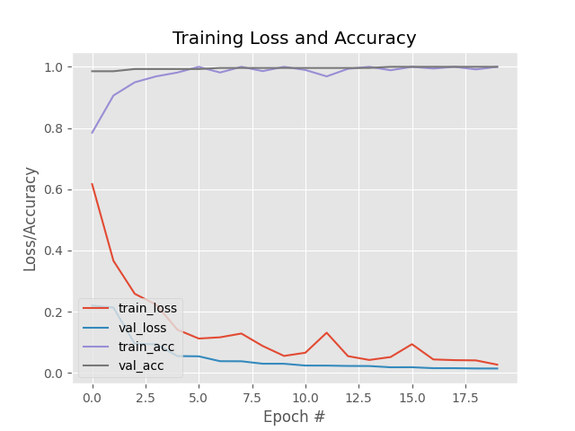

# Face Mask Detection System 🎭🚫🦠


A real-time, deep learning-based face mask detection system capable of identifying whether a person is wearing a mask or not in live video streams. Built with Python, OpenCV, and MobileNetV2.

## 🚀 Features

- **Real-Time Detection**: Processes video frames instantly from a webcam feed.
- **High Accuracy**: Utilizes MobileNetV2 (Transfer Learning) achieving ~99% accuracy.
- **Robust Pipeline**: Includes Face Detection (Caffe Model) → ROI Extraction → Mask Classification.
- **Cross-Platform**: Optimized for macOS (Apple Silicon support) and standard Linux/Windows environments.
- **User-Friendly Visualization**: Clear bounding boxes and confidence scores (Green for Mask, Red for No Mask).

## 🛠️ Tech Stack

- **Language**: Python 3.9+
- **Deep Learning**: TensorFlow / Keras (MobileNetV2 backbone)
- **Computer Vision**: OpenCV (DNN module for face detection)
- **Data Manipulation**: NumPy, Scikit-learn, Imutils
- **Visualization**: Matplotlib

## 📂 Project Structure

```
├── dataset/                  # Training data (Generated by setup script)
├── face_detector/            # Pre-trained Caffe models for face detection
├── detect_mask_video.py      # Main script for real-time detection
├── train_mask_detector.py    # Script to retrain the model
├── setup_dataset.py          # Automates dataset downloading & structuring
├── requirements.txt          # Python dependencies
├── mask_detector.h5          # Trained model weights (generated)
└── plot.png                  # Training history plot (generated)
```

## ⚙️ Installation

### 1. Clone the Repository
```bash
git clone https://github.com/pronzzz/face-mask-detection.git
cd face-mask-detection
```

### 2. Create a Virtual Environment (Recommended)
```bash
python3 -m venv venv
source venv/bin/activate  # On Windows: venv\Scripts\activate
```

### 3. Install Dependencies
```bash
pip install -r requirements.txt
```
*Note for macOS (M1/M2/M3) users: If you encounter specific TensorFlow issues, ensure you are using `tensorflow-macos` and `tensorflow-metal`.*

### 4. Setup Dataset
Run the automation script to download the necessary face detection models and the dataset:
```bash
python3 setup_dataset.py
```

## 🏃 Usage

### 🎥 Real-Time Detection
To start the webcam and detect masks:
```bash
python3 detect_mask_video.py
```
- Press `q` to quit the application.

### 🧠 Training the Model
If you want to retrain the classifier from scratch:
```bash
python3 train_mask_detector.py
```
This process will:
1. Load images from `dataset/`
2. Apply data augmentation
3. Fine-tune MobileNetV2
4. Save the model to `mask_detector.h5`
5. Generate a training metrics plot `plot.png`

## 📊 Results

The model was trained for 20 epochs with the following performance:
- **Accuracy**: ~99%
- **Precision/Recall**: ~1.00 for both classes



## 🐛 Troubleshooting

**macOS "Library not loaded" / Mutex errors:**
- Ensure you are using a clean virtual environment.
- Install `tensorflow-macos` explicitly if needed.
- This project includes fixes for common plotting backend issues (`matplotlib.use("Agg")`).

## 📜 License

Distributed under the MIT License. See `LICENSE` for more information.

## 🙌 Credits

- Dataset provided by [Prajna Bhandary](https://github.com/prajnasb/observations).
- Face detection model courtesy of OpenCV's DNN module.
